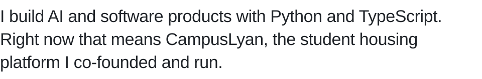
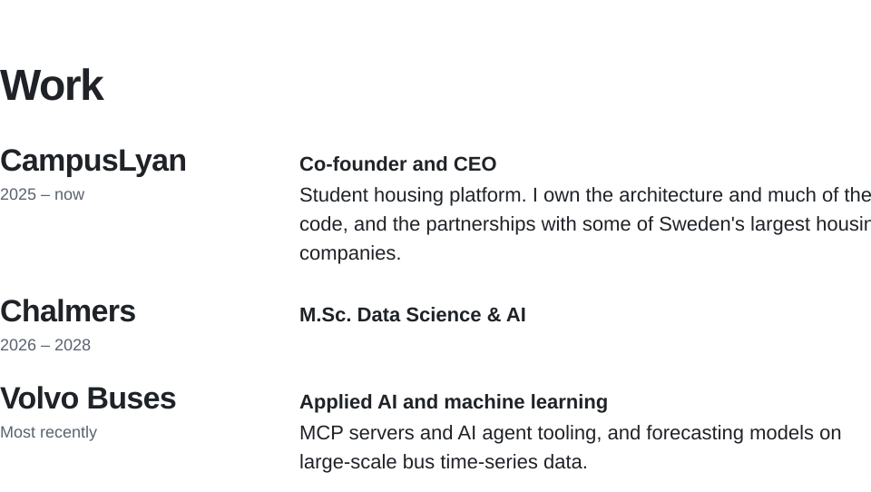
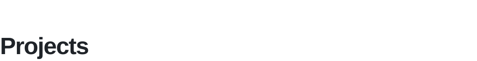
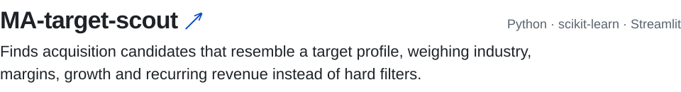
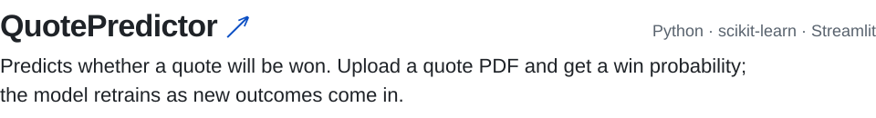
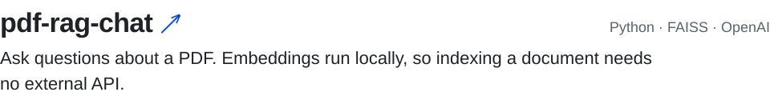
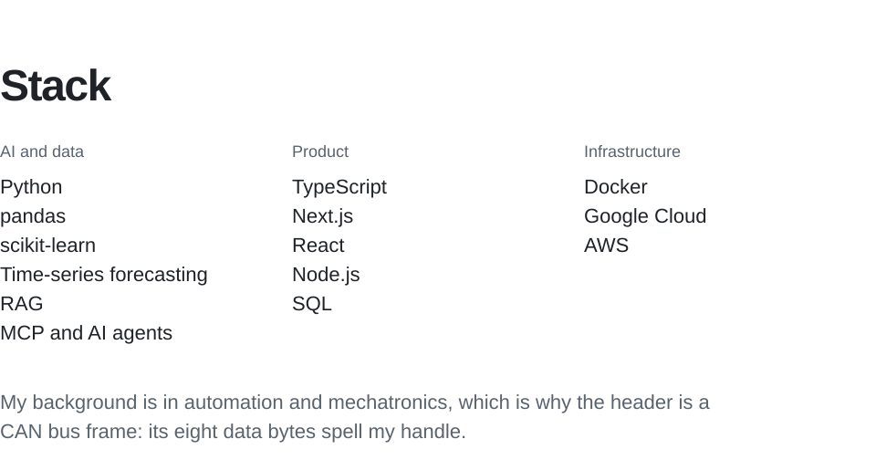
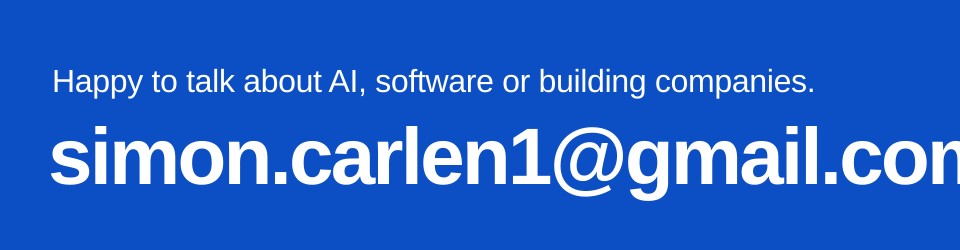

<!-- Generated by scripts/build.py. Edit the content there and run: python scripts/build.py -->

<a href="https://www.campuslyan.se/"><picture><source media="(prefers-color-scheme: dark)" srcset="assets/statement-dark.svg"></picture></a>

<a href="https://simon-portfolio-wine.vercel.app/en"><picture><source media="(prefers-color-scheme: dark)" srcset="assets/link-portfolio-dark.svg"></picture></a><a href="https://www.linkedin.com/in/simon-carlen/"><picture><source media="(prefers-color-scheme: dark)" srcset="assets/link-linkedin-dark.svg"></picture></a><a href="https://simon-portfolio-wine.vercel.app/en/cv.pdf"><picture><source media="(prefers-color-scheme: dark)" srcset="assets/link-cv-dark.svg"></picture></a><a href="mailto:simon.carlen1@gmail.com"><picture><source media="(prefers-color-scheme: dark)" srcset="assets/link-email-dark.svg"></picture></a>

<picture><source media="(prefers-color-scheme: dark)" srcset="assets/work-dark.svg"></picture>

<picture><source media="(prefers-color-scheme: dark)" srcset="assets/projects-dark.svg"></picture>

<a href="https://github.com/SimonC03/MA-target-scout"><picture><source media="(prefers-color-scheme: dark)" srcset="assets/project-ma-target-scout-dark.svg"></picture></a>

<a href="https://github.com/SimonC03/QuotePredictor"><picture><source media="(prefers-color-scheme: dark)" srcset="assets/project-quotepredictor-dark.svg"></picture></a>

<a href="https://github.com/SimonC03/pdf-rag-chat"><picture><source media="(prefers-color-scheme: dark)" srcset="assets/project-pdf-rag-chat-dark.svg"></picture></a>

<picture><source media="(prefers-color-scheme: dark)" srcset="assets/stack-dark.svg"></picture>

 

