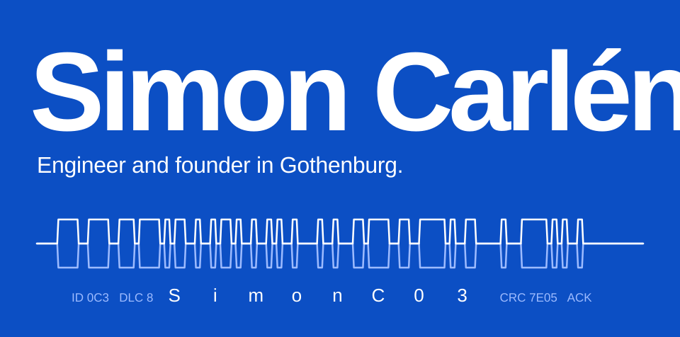

I build AI and software products with Python and TypeScript.

- 🏠 **Co-founder & CEO/CTO of [CampusLyan](https://www.campuslyan.se/)**, a student housing platform.
- 🎓 **M.Sc. Data Science & AI** at Chalmers (2026–2028), with a background in automation and mechatronics.
- 🚌 **Most recently, applied AI & ML at Volvo Buses**: MCP servers, AI agent tooling and time-series forecasting.
- 🏆 Nova 111 Student List 2026 · Adlerbert Scholarship ×3 · Chalmers Mastercard Scholarship
- 💬 Ask me about AI, software or building companies.

### Tech stack

**Also:** MCP & AI agents · RAG · time-series forecasting · CAN / Vector CANoe · HIL testing · Assembly

### Featured projects

| Project | What it does | Built with |
| :--- | :--- | :--- |
| [**MA-target-scout**](https://github.com/SimonC03/MA-target-scout) | Finds acquisition candidates that resemble a target profile. | Python, scikit-learn, Streamlit |
| [**QuotePredictor**](https://github.com/SimonC03/QuotePredictor) | Predicts the win probability of a quote from its PDF. | Python, scikit-learn, Streamlit |
| [**pdf-rag-chat**](https://github.com/SimonC03/pdf-rag-chat) | Ask questions about a PDF, with local embeddings. | Python, FAISS, OpenAI |
| [**stunote**](https://github.com/SimonC03/stunote) | Student platform for course literature, shared notes and AI-generated quizzes. Awarded the Chalmers Mastercard Scholarship. | Next.js, TypeScript, Tailwind |
