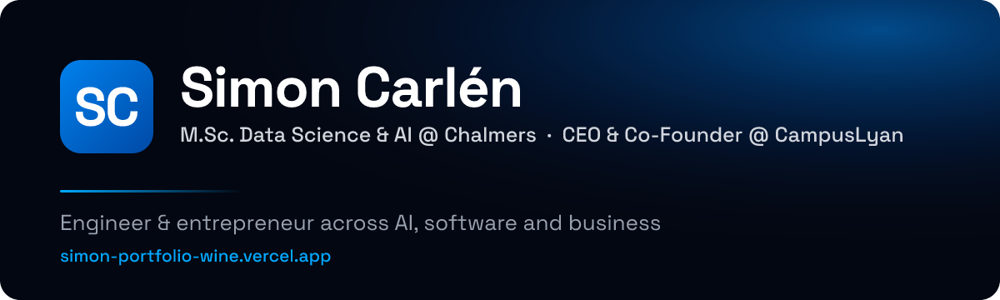

 

## Hi, I'm Simon 👋

Engineer and entrepreneur working at the intersection of **AI, software and business**, based in Gothenburg, Sweden.

- 🎓 **M.Sc. Data Science & AI** at Chalmers University of Technology (2026–2028), after a **B.Sc. in Automation & Mechatronics Engineering** with the highest results in the programme (GPA 4.9/5.0), studied in parallel with a **B.Sc. in Business Administration** at the School of Business, Economics and Law.
- 🚌 **Applied AI & ML at Volvo Buses** – built MCP servers and AI agent tooling, forecasting models on large-scale bus time-series data, and a browser-based AI agent extension. Before that, my bachelor thesis produced a **CAN-based vehicle simulation tool** for shift-left verification, tested on a physical HIL rig.
- 🏠 **CEO & Co-Founder of [CampusLyan](https://www.campuslyan.se/)** – building Sweden's student housing platform, from architecture and code to agreements with some of the country's largest housing companies.
- 🏆 **Nova 111 Student List 2026** · Adlerbert Scholarship ×3 · Chalmers Mastercard Scholarship · Former President & Group CEO of HandelsFöretagen (a parent company, six subsidiaries and 180+ employees).

## 🧰 Tech stack

**Languages**

**AI & Data**

**Web & Cloud**

**Vehicle & embedded**

## 🚀 Featured projects

| Project | What it is | Built with |
| :--- | :--- | :--- |
| [**MA-target-scout**](https://github.com/SimonC03/MA-target-scout) | AI-powered M&A screening pipeline: automated financial evaluation and NLP classification for private equity dealflow. | Python, NLP |
| [**QuotePredictor**](https://github.com/SimonC03/QuotePredictor) | Extracts key features from quote PDFs and predicts business outcomes from historical data. | Python, ML |
| [**pdf-rag-chat**](https://github.com/SimonC03/pdf-rag-chat) | Chat with your PDFs using retrieval-augmented generation. | Python, LLMs |
| [**Simon-portfolio**](https://github.com/SimonC03/Simon-portfolio) | My bilingual portfolio site with interactive experience, education and project pages. | Next.js, TypeScript, Tailwind |
| [**coding-playground**](https://github.com/SimonC03/coding-playground) | Python algorithms, ML experiments and code snippets. | Python, Jupyter |
| [**stunote**](https://github.com/SimonC03/stunote) | EdTech platform with a literature marketplace, note sharing and AI-generated quizzes. Awarded the Chalmers Mastercard Scholarship. | Next.js, TypeScript, MySQL, PHP |

More on my [portfolio](https://simon-portfolio-wine.vercel.app/en/projects), including the Volvo Buses work that lives outside GitHub.

## 📊 GitHub

<picture>
  <source media="(prefers-color-scheme: dark)" srcset="https://github-readme-stats.vercel.app/api?username=SimonC03&show_icons=true&hide_border=true&theme=github_dark&bg_color=00000000&title_color=00A9FF&icon_color=00A9FF" />
  
</picture>
<picture>
  <source media="(prefers-color-scheme: dark)" srcset="https://github-readme-stats.vercel.app/api/top-langs/?username=SimonC03&layout=compact&hide_border=true&theme=github_dark&bg_color=00000000&title_color=00A9FF" />
  
</picture>

 

<picture>
  <source media="(prefers-color-scheme: dark)" srcset="https://github.com/SimonC03/SimonC03/raw/output/github-contribution-grid-snake-dark.svg" />
  <source media="(prefers-color-scheme: light)" srcset="https://github.com/SimonC03/SimonC03/raw/output/github-contribution-grid-snake.svg" />
  
</picture>

  Open to conversations about AI, software and building companies. Reach me on <a href="https://www.linkedin.com/in/simon-carlen/">LinkedIn</a> or by <a href="mailto:simon.carlen1@gmail.com">email</a>.

